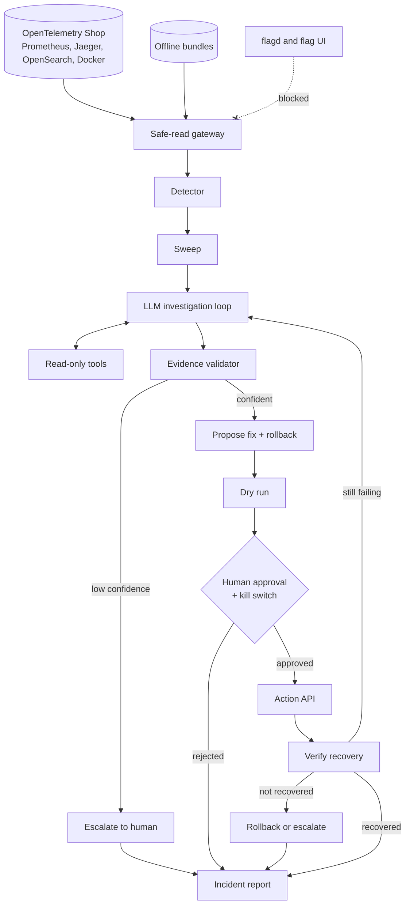

# Architecture — Team 1 AI On-Call Engineer

## What each part does
| Part | One-line definition |
|---|---|
| **OpenTelemetry Shop** | The demo microservices app we monitor, with Prometheus (metrics), Jaeger (traces), OpenSearch (logs) and Docker (containers). |
| **flagd and flag UI** | The feature-flag service that holds the fault switches; reading it is forbidden, so it is blocked. |
| **Offline bundles** | Recorded incident data used as a fallback if the live demo can't run. |
| **Safe-read gateway** | The single door for all reads, which filters out anything that could reveal flag settings. |
| **Detector** | Raises an alert when error rate, latency, traffic or container health crosses a threshold. |
| **Sweep** | A fixed first look at services, containers and restarts before digging deeper. |
| **LLM investigation loop** | The local LLM (Qwen3 8B) picks which tool to call next based on what it has found so far. |
| **Read-only tools** | Return short summaries of traces, metrics, logs and container health, each fact tagged with an evidence ID. |
| **Evidence validator** | Checks that cited evidence is real, that quoted values match, and lowers confidence when data is missing. |
| **Escalate to human** | When confidence is low, hands over the findings instead of guessing. |
| **Propose fix + rollback** | Picks an allowlisted runbook action and an undo plan. |
| **Dry run** | A read-only preview of what the fix would do. |
| **Human approval + kill switch** | Nothing changes without an explicit yes, and the kill switch can stop everything at any time. |
| **Action API** | The only allowed way to change the system, with every call logged. |
| **Verify recovery** | Re-checks the same signals that raised the alert to confirm the system recovered. |
| **Rollback or escalate** | Undoes the approved fix or hands over to a human if recovery failed. |
| **Incident report** | Final output: timeline, root cause, evidence, action taken and prevention, in the required JSON schema plus a readable version. |
