# Architecture — Team 1 AI On-Call Engineer

The agent detects an incident in the OpenTelemetry Astronomy Shop, investigates it with
read-only tools, names the root cause with checked evidence, and (with human approval)
applies an allowlisted fix through the Action API, then verifies recovery and reports.

**One-line summary:** a local, tool-calling LLM agent (Qwen3 8B via Ollama) wrapped in a
deterministic state machine. All reads go through a safe-read gateway; all writes go
through a human-approved Action API.

**Design principles**
1. **Never read feature-flag settings.** Every read goes through one safe-read gateway.
2. **Never act without human approval.** Only the Action API can change the system.
3. **When unsure, say so.** Low confidence means escalate with findings, not a guess.

## Background: feature flags and flagd
A *feature flag* is an on/off switch in an application's code that changes behavior without
redeploying. *flagd* is the service that stores flag values and answers apps asking "is this
flag on?". The OpenTelemetry demo uses flags as its **fault switches** (for example, payment
failing, cart failing intermittently, a memory leak in recommendations), so the flag settings
are effectively the answer key to "what is broken right now".

- **Not allowed:** reading flag settings (flagd files, flag UI, flag API) to diagnose. Diagnosis must come from telemetry. Violations mean disqualification.
- **Allowed:** *toggling* a flag through the Action API as an approved runbook fix.
- The answer key can leak through other routes too: flagd's own logs and traces, `docker logs` / `docker inspect` of the flagd container, the flag config file inside the `opentelemetry-demo/` folder, and other services that log which flag variant they used. The safe-read gateway exists to block all of these.

## System diagram

```mermaid
flowchart LR
    subgraph Demo["OpenTelemetry Astronomy Shop (Docker)"]
        SVC[Microservices] --> COL[OTel Collector]
        COL --> PROM[(Prometheus<br/>metrics)]
        COL --> JAE[(Jaeger<br/>traces)]
        COL --> OS[(OpenSearch<br/>logs)]
        DOCK[(Docker engine<br/>container state)]
        FLAG[flagd and flag UI]
    end

    OFF[(Offline incident bundles<br/>fallback)]

    subgraph Agent["Our agent (Python, local)"]
        GW["Safe-read gateway<br/>flag filter, field scrubbing,<br/>docker and file limits"]
        DET[Detector<br/>rule-based alerts] --> SWEEP[Fixed sweep<br/>overview, containers, restarts]
        SWEEP --> LOOP[Qwen3 8B via Ollama<br/>picks follow-up tools<br/>adaptive step and time cap]
        LOOP <--> TOOLS[Read-only tools<br/>summaries + evidence ids<br/>incl. deploy history]
        LOOP --> DIAG[Diagnosis JSON]
        DIAG --> VAL["Evidence validator<br/>ids exist, values match,<br/>coverage-aware confidence"]
        VAL -->|confidence below 0.7| ESC[Escalate to human<br/>with findings]
        VAL -->|confidence 0.7 or more| PROP[Propose allowlisted fix<br/>plus rollback plan]
        PROP --> DRY[Dry run<br/>read-only preview]
        DRY --> APPROVE{Human approval<br/>kill switch active}
        APPROVE -->|rejected| REP
        APPROVE -->|approved| ACT[Action API<br/>plus audit log]
        ACT --> VERIFY[Verify recovery<br/>re-check alert signals]
        VERIFY -->|still failing or new symptom| LOOP
        VERIFY -->|not recovered| RB[Approved rollback<br/>or escalate]
        VERIFY -->|recovered| REP
        RB --> REP
        ESC --> REP[Incident report<br/>provided JSON schema + markdown]
    end

    PROM --> GW
    JAE --> GW
    OS --> GW
    DOCK --> GW
    OFF --> GW
    GW --> DET
    GW --> TOOLS
    FLAG -. blocked at every layer .-x GW
```

## The flow, step by step
1. **Detect:** the detector watches the shop's numbers and raises an alarm on error spikes, latency jumps or a dead container.
2. **Sweep:** a fixed first look at services, containers and restarts.
3. **Investigate:** the LLM picks the next tool (traces, logs, metrics) based on what it has found so far.
4. **Diagnose:** the LLM states what broke, why, how sure it is, and which evidence proves it.
5. **Validate:** code checks the evidence is real. Fake or missing evidence lowers confidence.
6. **Escalate:** if confidence is low, stop and hand the findings to a human (a correct outcome per the brief).
7. **Propose:** pick a fix from the allowlist and a rollback plan.
8. **Dry run and approval:** the human sees the preview, diagnosis, evidence, fix and rollback, then says yes or no.
9. **Act:** apply the fix through the Action API only.
10. **Verify:** re-check the signals that raised the alert.
11. **Re-investigate:** if anything is still failing, loop back (there may be two faults).
12. **Rollback or escalate:** if the fix failed, apply the pre-approved rollback or hand over to a human.
13. **Report:** timeline, root cause, evidence, action taken, prevention.

## Layers: what each part does and what problem it solves

### Layer 1 — Eyes (reading the system)
| Part | Problem it solves |
|---|---|
| **Safe-read gateway** | Reading flag settings means disqualification, and flag info can leak by many routes. One door for all reads enforces the rule in one place, so a new tool can't forget it. |
| **Flag filter** | flagd's own logs, spans and metrics would reveal "flag X is on". Removes flagd from OpenSearch, Jaeger, Prometheus and docker results. |
| **Field scrubbing** | Other services may record flag evaluations in their spans or logs. Strips those fields before anything reaches the LLM. |
| **Docker limits, no filesystem reads** | `docker inspect` can show env vars and mount paths, and the demo folder holds the flag config file. Only name, status, health, restarts, CPU and memory are exposed. |
| **Observe tools with evidence IDs `[E#]`** | Raw telemetry overflows a 16k context and makes the LLM guess. Code computes numbers and returns short summaries, each fact tagged with an ID so it can be cited and checked. |
| **Coverage reporting** | Only some services emit metrics and logs, so "no data" can look like "healthy". Each tool reports what it could and couldn't see. |
| **Deploy history tool** | Engineers check recent changes first. Lets the agent correlate a failure with a deployment, without touching flag data. Source to be confirmed with a mentor. |
| **Offline adapter** | A weak laptop or a crashed demo would block the team. Same tool interface over recorded incident bundles. |

### Layer 2 — Brain (thinking)
| Part | Problem it solves |
|---|---|
| **Detector** | The agent must start from an alert on its own. Rules: error rate > 5%, p95 > 3x baseline, traffic drop, container down. 2 consecutive polls avoid false alarms (1 poll if severe). |
| **Sweep** | An LLM alone may skip obvious checks. Every investigation starts from the same baseline. |
| **LLM investigation loop** | A fixed script can't handle unseen incidents; an unbounded loop can run forever. The LLM picks tools from what it found, with step and time limits. |
| **Diagnosis JSON** | Free text can't be scored or validated. Structured output: root cause, confidence, cited evidence, in the provided schema. |
| **Validator** | LLMs invent evidence, and invented evidence is penalised. Drops IDs no tool produced, checks that quoted values match stored data, lowers confidence when the blamed service has no data. |
| **0.7 threshold and escalation** | A confident wrong fix is the worst outcome. Low confidence stops the agent and hands findings to a human. The threshold is checked against practice-set accuracy. |

### Layer 3 — Hands (acting)
| Part | Problem it solves |
|---|---|
| **Allowlist plus rollback plan** | An agent that can run anything is dangerous and could be tuned to practice incidents. Only runbook actions, chosen from the diagnosed component and category, with an undo decided up front. |
| **Dry run** | Humans approve blindly if they can't see the effect. A read-only preview, the only thing allowed without approval. |
| **Human approval gate** | No action without approval is a hard rule. Shows diagnosis, evidence, fix and rollback together and waits for an explicit yes. |
| **Kill switch** | Something may go wrong mid-run. Checked before every action, between steps and while waiting for approval; cancels a pending approval and stops a running action. |
| **Action API client and audit log** | Any other write path breaks the rules. The only code that changes the system, with our own log beside the API's. |
| **Verify** | "The command ran" doesn't mean the system recovered. Re-checks the same signals that raised the alert over a settling window. |
| **Loop back after verify** | Unseen incidents may combine two faults. If anything is still failing, return to investigation (up to N rounds). |
| **Approved rollback or escalate** | A failed fix can make things worse, but an automatic rollback would be an unapproved action. The rollback is part of the plan the human already approved; otherwise escalate. |

### Layer 4 — Reporting and evaluation
| Part | Problem it solves |
|---|---|
| **Timeline logger** | Judges score explainability. Every step, tool call and decision is recorded with timestamps. |
| **JSON schema and markdown report** | Output not matching the schema can't be auto-scored. Machine-readable for the scorer, readable for humans. |
| **Practice harness** | Can't know the agent works, or write an honest evaluation note, without repeated runs. Runs every practice incident (including combined faults) and scores diagnosis and recovery. Kept separate from the organisers' scoring harness, which we never touch. |
| **Leak tests** | A leak you didn't notice still counts as disqualification. Automatically tries each leak route and proves it is blocked. |

## Loopholes covered
| Loophole | Covered by |
|---|---|
| Reading flag settings | Gateway, flag filter, field scrubbing, docker and file limits, leak tests |
| Acting without approval | Approval gate, Action API as the only write path, rollback pre-approved |
| Invented evidence | Evidence IDs and value validator |
| Confident wrong fix | 0.7 threshold, escalation |
| Hard-coding practice answers | Generic tools, allowlist keyed on component and category |
| Missing data read as healthy | Coverage reporting |
| Combined or unseen faults | Loop back after verify, generic analyzers |
| Fix applied but not working | Verify, then approved rollback or escalate |
| Demo or laptop failure | Offline adapter |
| LLM breaks or is slow | Strict JSON validation with retries, rule-based fallback summary, time caps |

## Components
| Component | File | Role | Status |
|---|---|---|---|
| Detector | `agent/detector.py` | Rule-based alerts, 2 consecutive polls (1 if severe) | Done |
| Raw clients | `agent/tools/` | Prometheus, Jaeger (v3/legacy), OpenSearch, docker `ps/inspect/stats`, read-only | Done |
| Safe-read gateway | `agent/gateway.py` | Single door for all reads: flag filter, field scrubbing, docker and filesystem limits | Planned (priority 1) |
| Investigation tools | `agent/observe.py` | 8 tools, summaries with `[E#]` ids; add deploy history | Done / deploy history planned |
| Evidence ledger | `agent/evidence.py` | Every observed fact gets an id and a stored value | Done |
| Brain | `agent/brain.py` | Sweep, LLM tool loop, JSON diagnosis, validation, act or escalate | Done |
| Orchestrator | `agent/orchestrator.py` | State machine, loop after verify, approval ordering, timeline | Planned |
| Offline adapter | `agent/offline.py` | Same tool interface over recorded bundles | Planned |
| Validator upgrade | `safety/validator.py` | Value checks, coverage-aware confidence | Planned |
| Action layer | `safety/` | Allowlist, dry run, approval gate, kill switch, Action API client, audit log, verifier | Day 2 |
| Reporting | `reporting/` | Provided JSON schema, markdown report, timeline | Day 2 |
| Practice harness | `eval/harness.py` | Runs practice incidents including combined faults | Planned |
| Leak tests | `tests/test_flag_leaks.py` | Proves every flag-leak route is blocked | Planned (priority 1) |

## How it decides
- **Which tool next:** the LLM chooses from the tool list after seeing the sweep. Service arguments are restricted to real service names. Tool-call JSON is validated strictly, with a retry on malformed output.
- **Root cause:** error *origin* = deepest failing span in sampled traces, cross-checked with per-operation error rates, logs and container state.
- **Missing data:** a service with no metrics or logs lowers confidence instead of counting as healthy.
- **Act vs escalate:** propose a fix only if confidence is at least 0.7, the category is known, cited evidence mentions the blamed service, and the validator confirms the quoted values. Otherwise escalate with findings.
- **Combined faults:** after verify, if the alert persists or another service is failing, loop back to investigation (limited to N rounds).
- **No matching fix:** faults with no allowlisted action (for example network latency or packet loss) are diagnosed and escalated, with the reason stated.

## Safety controls
- **Safe-read gateway:** URL deny list for flagd, flag UI and flag API; flagd filtered out of logs, spans, metrics and docker results; flag-evaluation fields scrubbed; docker output limited to name, status, health, restarts, CPU and memory; no reads inside `opentelemetry-demo/`.
- **Diagnosis comes from telemetry only:** no fault-to-flag mappings and no hard-coded practice answers.
- **Human approval:** the plan shown includes diagnosis, evidence, fix and rollback plan. Only read-only dry runs run without approval.
- **Kill switch:** checked before every action, between steps and during approval wait.
- **Action API is the only write path**, with our own audit log beside the API's.
- **No auto-approve in the shipped path.** Any test mode is separate, clearly named and off by default.
- Fully local: no data leaves the laptop.

## Output
Diagnosis and incident reports follow the **provided JSON schema** from the template. Extra fields (tool trail and so on) go in a separate section. A readable markdown report (timeline, root cause, evidence, action taken, prevention) is produced alongside.

## Known limitations
- Qwen3 8B can be slow or weak at tool calling; handled with strict validation, retries and a rule-based fallback summary.
- Some services have sparse metrics or logs, which lowers confidence.
- Faults with no allowlisted action are escalated, not fixed.
- Action layer, reporting and the orchestrator loop are Day 2 work; the status column shows what is built.
