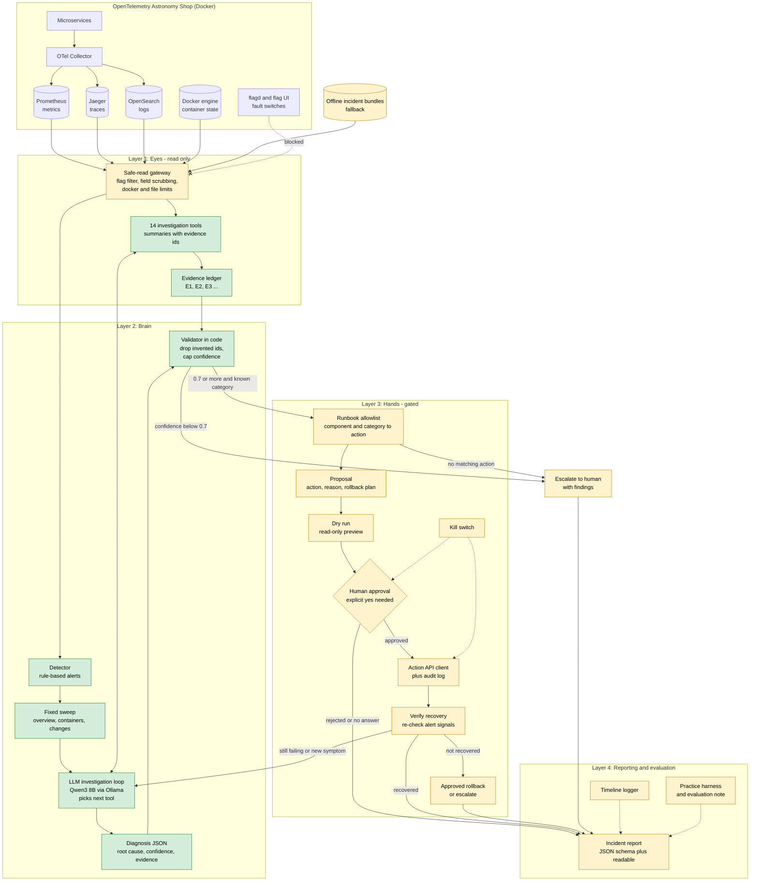

# Architecture — Team 1 AI On-Call Engineer

## Legend
| Layer | Job |
|---|---|
| **Eyes** | Reads telemetry safely and turns it into short summaries with evidence IDs |
| **Brain** | Detects, investigates with the LLM, diagnoses, and validates the evidence in code |
| **Hands** | Picks an allowlisted fix, asks a human, acts through the Action API, verifies |
| **Reporting and evaluation** | Timeline, incident report, practice runs and the evaluation note |

## Rules the design enforces
1. Never read feature-flag settings: everything is read through one gateway.
2. Never act without human approval: the Action API is reachable only after the approval gate.
3. When unsure (below 0.7 confidence), escalate with findings instead of guessing.

## What each part does
| Part | One-line definition |
|---|---|
| **OpenTelemetry Shop** | The demo microservices app we monitor, with Prometheus (metrics), Jaeger (traces), OpenSearch (logs) and Docker (containers). |
| **flagd and flag UI** | The feature-flag service that holds the fault switches; reading it is forbidden, so it is blocked. |
| **Offline bundles** | Recorded incident data used as a fallback if the live demo can't run. |
| **Safe-read gateway** | The single door for all reads, which filters out anything that could reveal flag settings. |
| **Detector** | Raises an alert when error rate, latency, traffic or container health crosses a threshold. |
| **Sweep** | A fixed first look at services, containers and restarts before digging deeper. |
| **LLM investigation loop** | The local LLM (Qwen3 8B) picks which tool to call next based on what it has found so far. |
| **Read-only tools** | Return short summaries of metrics, traces, logs, container health, the Valkey cache, the Postgres database (`db_health`: down vs slow/lock contention behind product-catalog), network latency between services, error breakdown by attribute, single-trace and trace-log lookup, and the Kafka queue, each fact tagged with an evidence ID. |
| **Evidence validator** | Checks that cited evidence is real, that quoted values match, and lowers confidence when data is missing. |
| **Escalate to human** | When confidence is low, hands over the findings instead of guessing. |
| **Propose fix + rollback** | Picks an allowlisted runbook action and an undo plan. |
| **Dry run** | A read-only preview of what the fix would do. |
| **Human approval + kill switch** | Nothing changes without an explicit yes, and the kill switch can stop everything at any time. |
| **Action API** | The only allowed way to change the system, with every call logged. |
| **Verify recovery** | Re-checks the same signals that raised the alert to confirm the system recovered. |
| **Rollback or escalate** | Undoes the approved fix or hands over to a human if recovery failed. |
| **Incident report** | Final output: timeline, root cause, evidence, action taken and prevention, in the required JSON schema plus a readable version. |
