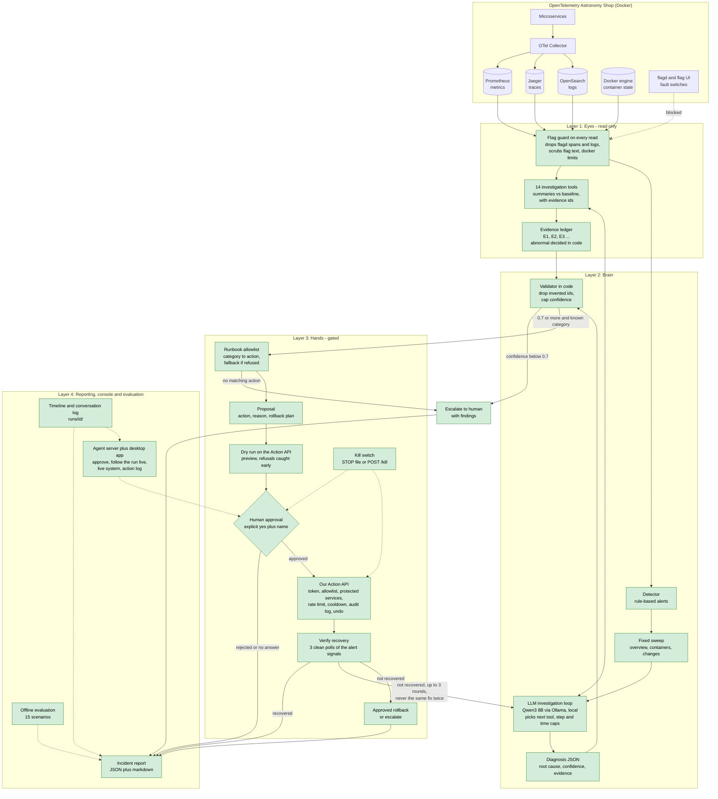

# Architecture — Team 1 AI On-Call Engineer

## Legend
| Layer | Job |
|---|---|
| **Eyes** | Reads telemetry safely and turns it into short summaries with evidence IDs |
| **Brain** | Detects, investigates with the LLM, diagnoses, and validates the evidence in code |
| **Hands** | Picks an allowlisted fix, asks a human, acts through our Action API, verifies |
| **Reporting, console and evaluation** | Timeline, conversation log, incident report, desktop console, offline evaluation |

## Rules the design enforces
1. Never read feature-flag settings: every tool output passes through the flag guard, and the model never sees a flag name.
2. Never act without human approval: the Action API is the only write path and refuses any execute without an approval record.
3. When unsure (below 0.7 confidence), escalate with findings instead of guessing.

## What each part does
| Part | One-line definition |
|---|---|
| **OpenTelemetry Shop** | The demo microservices app we monitor, with Prometheus (metrics), Jaeger (traces), OpenSearch (logs) and Docker (containers). |
| **flagd and flag UI** | The feature-flag service that holds the fault switches; reading it is forbidden, so it is blocked from every read. Only the Action API touches it, to turn a feature off after approval. |
| **Offline scenarios** | 15 recorded-style incidents served by fake backends, used for tests and the evaluation; the agent never imports them. |
| **Flag guard** | `agent/flagguard.py`: removes flagd's spans and logs, client calls to flagd, flag-UI access logs and any flag text from every tool output. |
| **Detector** | Raises an alert on error rate, per-operation errors, latency, traffic drop or spike, a stopped or restarting container, a memory leak or CPU starvation; must hold for 2 polls. |
| **Sweep** | A fixed first look at services, containers and restarts before digging deeper; a manual page with nothing abnormal stops here without calling the model. |
| **LLM investigation loop** | The local LLM (Qwen3 8B) picks which tool to call next based on what it has found so far: at most 8 steps, 8 calls, 180 seconds. |
| **Read-only tools** | Return short summaries of metrics, traces, logs, container health, the Valkey cache, the Postgres database (`db_health`: down vs slow/lock contention behind product-catalog), network latency between services, error breakdown by attribute, single-trace and trace-log lookup, and the Kafka queue, each fact tagged with an evidence ID and compared to a baseline. |
| **Evidence validator** | Drops evidence ids no tool produced and caps confidence when no cited evidence is abnormal or the blamed service is not in the evidence. |
| **Escalate to human** | When confidence is low, hands over the findings instead of guessing. |
| **Propose fix + rollback** | Picks an allowlisted runbook action by category (restart, turn off a service's features, throttle load) and an undo plan; if the Action API refuses it, tries the fallback (restart ↔ feature off). |
| **Dry run** | The Action API checks the action and previews it (for a feature-off: which features it would turn off) without changing anything. |
| **Human approval + kill switch** | Nothing changes without an explicit yes and a name; the kill switch (STOP file or POST /kill) blocks every execute. |
| **Action API** | Our own local server and the only way to change the system: token, allowlist, protected monitoring services, 5 actions per 10 minutes, 60 s cooldown per target, audit log, undo. |
| **Verify recovery** | Re-checks the alerting signals until 3 polls in a row are clean, and tells "our target recovered but another fault remains" apart from "not recovered". |
| **Rollback or escalate** | Undoes the approved fix (if the human agrees) or hands over to a human; up to 3 rounds, never repeating a fix. |
| **Incident report** | Final output: timeline, root cause, evidence, action taken, rounds and prevention, as JSON plus a readable version. |
| **Agent server + desktop app** | `agent/server.py` runs the pipeline and serves the Electron console (`ui/desktop`): approve fixes, follow each run's conversation with the model live, see the live system and the Action API log. |
