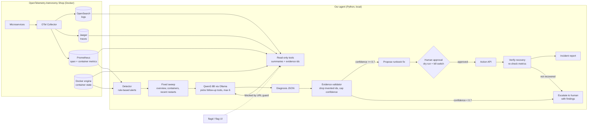

# Architecture — Team 1 AI On-Call Engineer

## Components
| Component | File | Role |
|---|---|---|
| Detector | `agent/detector.py` | Error rate > 5%, p95 > 3x baseline, traffic drop, container down; 2 consecutive polls |
| Raw clients | `agent/tools/` | Prometheus, Jaeger (v3/legacy), OpenSearch, docker `ps/inspect/stats` — read-only |
| Investigation tools | `agent/observe.py` | 8 tools; numbers computed in code, output is a short summary with `[E#]` evidence ids |
| Evidence ledger | `agent/evidence.py` | Every observed fact gets an id; only these can be cited |
| Brain | `agent/brain.py` | Sweep → LLM tool loop → JSON diagnosis → validation → act/escalate decision |
| Action layer | *Day 2* | Allowlisted runbook actions via Action API, human approval, dry run, kill switch, verify |

## How it decides
- **Which tool next:** the LLM chooses from the tool list after seeing the sweep; service arguments are restricted to real service names.
- **Root cause:** error *origin* = deepest failing span in sampled traces, cross-checked with per-operation error rates, logs and container state.
- **Act vs escalate:** propose a fix only if confidence ≥ 0.7, the category is known, and cited evidence mentions the blamed service. Otherwise escalate with findings.

## Safety controls
- Telemetry access is read-only; feature-flag sources are refused at the HTTP layer.
- The agent can only change the system through the Action API, only after explicit human approval.
- Dry-run mode and a kill switch (Day 2).
- Fully local: no data leaves the laptop.
