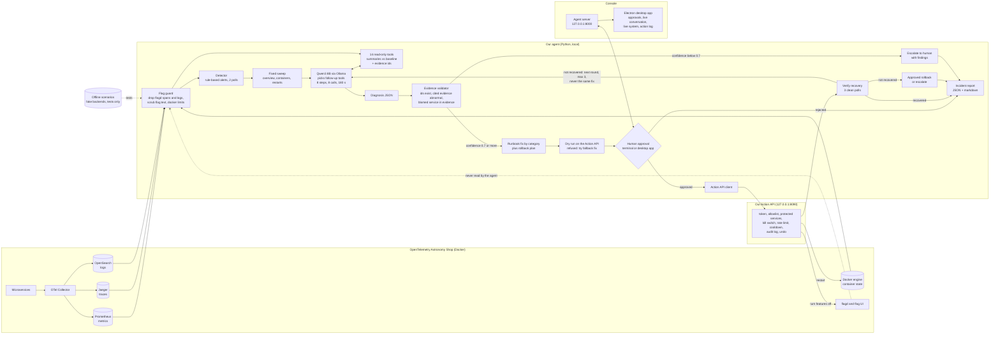

# Architecture — Team 1 AI On-Call Engineer

The agent detects an incident in the OpenTelemetry Astronomy Shop, investigates it with
read-only tools, names the root cause with checked evidence, and (with human approval)
applies an allowlisted fix through the Action API, then verifies recovery and reports.

**One-line summary:** a local, tool-calling LLM agent (Qwen3 8B via Ollama) wrapped in a
deterministic pipeline. Every read passes through a flag guard; every write goes through our
own human-approved Action API. No agent framework (no LangChain/LangGraph): plain Python.

**Design principles**
1. **Never read feature-flag settings.** Every tool output passes through one flag guard.
2. **Never act without human approval.** Only the Action API can change the system.
3. **When unsure, say so.** Low confidence means escalate with findings, not a guess.

## Background: feature flags and flagd
A *feature flag* is an on/off switch in an application's code that changes behavior without
redeploying. *flagd* is the service that stores flag values and answers apps asking "is this
flag on?". The OpenTelemetry demo uses flags as its **fault switches** (for example, payment
failing, cart failing intermittently, a memory leak in recommendations), so the flag settings
are effectively the answer key to "what is broken right now".

- **Not allowed:** reading flag settings (flagd files, flag UI, flag API) to diagnose. Diagnosis must come from telemetry. Violations mean disqualification.
- **Allowed:** *toggling* a flag through the Action API as an approved runbook fix.
- The answer key can leak through other routes too: flagd's own logs and traces, `docker logs` / `docker inspect` of the flagd container, the flag config file inside the `opentelemetry-demo/` folder, and other services that log which flag variant they used. The flag guard and the read-only tools exist to block all of these.

## System diagram

## The flow, step by step
1. **Detect:** the detector polls Prometheus and Docker and raises an alert on error spikes, per-operation errors, latency jumps, traffic drops or spikes, a stopped or crash-looping container, a memory leak or CPU starvation. It must hold for 2 polls.
2. **Sweep:** a fixed first look at services (with baseline), containers and recent restarts. A manual page where nothing is abnormal ends here without calling the model.
3. **Investigate:** the LLM picks the next tool (operations, traces, logs, resources, dependencies) based on what it has found so far.
4. **Diagnose:** the LLM states what broke, why, how sure it is, and which evidence ids prove it, as JSON.
5. **Validate:** code checks the evidence is real and abnormal. Fake or weak evidence lowers confidence.
6. **Escalate:** if confidence is low, stop and hand the findings to a human (a correct outcome per the brief).
7. **Propose:** pick a fix from the runbook for the diagnosed category, plus a rollback plan.
8. **Dry run and approval:** the Action API checks and previews the fix; if it refuses, the fallback fix is tried. The human sees diagnosis, evidence, other problems seen, fix and preview, then types yes and their name.
9. **Act:** apply the fix through the Action API only.
10. **Verify:** re-check the alerting signals until 3 polls in a row are clean.
11. **Re-investigate:** if not recovered, investigate again knowing what was tried (up to 3 rounds, never the same fix twice).
12. **Rollback or escalate:** if the fix failed, offer the rollback (human decides) or hand over to a human. If our target recovered but another fault remains, say so and escalate that part.
13. **Report:** timeline, root cause, evidence, action taken, rounds, prevention.

## Layers: what each part does and what problem it solves

### Layer 1 — Eyes (reading the system)
| Part | Problem it solves |
|---|---|
| **Flag guard (`agent/flagguard.py`)** | Reading flag settings means disqualification, and flag info can leak by many routes. Every tool output passes through it, so a new tool can't forget the rule. |
| **Flag filter** | flagd's own logs and spans, and other services' calls to flagd, would reveal "flag X is on". Removed from OpenSearch and Jaeger results. |
| **Field scrubbing** | Span attributes and log lines may name a flag. Any string that mentions flags is redacted whole before it reaches the LLM. |
| **Docker limits, no filesystem reads** | `docker inspect` can show env vars and mount paths, and the demo folder holds the flag config file. Only state, exit code, OOM, restarts, CPU and memory are exposed. |
| **Read-only tools with evidence IDs `[E#]`** | Raw telemetry overflows a 16k context and makes the LLM guess. Code runs fixed queries, compares to a baseline (last 2 min vs the 15 min ending 20 min ago) and returns short summaries, each fact tagged with an ID and an abnormal flag decided in code. |
| **Noise handling** | The demo starting up, payment's memory warm-up, the monitoring stack's high memory and our own restarts look like incidents. The tools recognise and skip them. |
| **Deploy history (`recent_changes`)** | Engineers check recent changes first. Uses container start times as a proxy, without touching flag data. |
| **Offline scenarios (`eval/`)** | A crashed demo would block testing. Fake Prometheus, Jaeger, OpenSearch and Docker backends serve 15 scenarios behind the same tool interface; the agent never imports them. |

### Layer 2 — Brain (thinking)
| Part | Problem it solves |
|---|---|
| **Detector** | The agent must start from an alert on its own. Rules: error rate > 5% with at least 2 errors (so quiet services still alert), per-operation errors > 10%, p95 > 3x baseline and > 300 ms, traffic drop, traffic spike > 3x, container stopped or restarting, memory leak, CPU starved. 2 consecutive polls avoid false alarms. |
| **Sweep** | An LLM alone may skip obvious checks. Every investigation starts from the same baseline. |
| **LLM investigation loop** | A fixed script can't handle unseen incidents; an unbounded loop can run forever. The LLM picks tools from what it found, capped at 8 steps, 2 calls per step, 8 calls and 180 seconds. |
| **Diagnosis JSON** | Free text can't be scored or validated. Structured output: root cause (service, category, description), confidence, cited evidence. Invalid JSON gets one retry, then escalation. |
| **Validator** | LLMs invent evidence. Drops IDs no tool produced; caps confidence at 0.2 with no valid evidence, 0.3 if none of it is abnormal, 0.4 if the blamed service is not in the evidence. |
| **0.7 threshold and escalation** | A confident wrong fix is the worst outcome. Low confidence or an unknown category stops the agent and hands findings to a human. |

### Layer 3 — Hands (acting)
| Part | Problem it solves |
|---|---|
| **Runbook plus rollback plan (`agent/actions.py`)** | An agent that can run anything is dangerous and could be tuned to practice incidents. Fix chosen by category: container/database/cache down → restart; service error, dependency failure, resource exhaustion → turn off that service's enabled features; traffic spike → throttle the load generator. Undo decided up front. |
| **Automatic feature selection** | The agent never reads flags, so it can't name one. It asks the Action API to turn off the features related to the diagnosed service; the API picks them and the dry run shows which, so the human approves an exact change. The model never sees the flag names. |
| **Dry run** | Humans approve blindly if they can't see the effect, and a fix the API will refuse (for example restarting a protected service) should not reach the human. The API checks and previews; if refused, the fallback fix (restart ↔ feature off) is tried. |
| **Human approval gate** | No action without approval is a hard rule. Shows diagnosis, evidence, other problems seen, fix and preview, and waits for an explicit yes plus a name, from the terminal or the desktop app. |
| **Kill switch** | Something may go wrong mid-run. A STOP file in the repo or POST /kill; the Action API refuses every execute while it is on. |
| **Action API (`action_api/`)** | Any other write path breaks the rules. Our own local server: bearer token, allowlist, protected monitoring services, approval record required, 5 executes per 10 minutes, 60 s cooldown per target, audit log of every call, undo. |
| **Verify** | "The command ran" doesn't mean the system recovered. Re-checks the alerting signals until 3 polls in a row are clean, and separates "our target recovered" from "another fault remains". |
| **Loop back after verify** | Unseen incidents may combine two faults. Up to 3 rounds, each knowing what was tried; never the same fix twice. |
| **Approved rollback or escalate** | A failed fix can make things worse, but an automatic rollback would be an unapproved action. The human is asked; otherwise escalate. |

### Layer 4 — Reporting, console and evaluation
| Part | Problem it solves |
|---|---|
| **Timeline and conversation log** | Judges score explainability. `runs/<id>/` holds every phase with timestamps, plus the full conversation: what was sent to the model, each tool call and output, the model's reasoning, the validator's checks, and every question to the human with the answer. |
| **JSON and markdown report** | Machine-readable for scoring, readable for humans: outcome, root cause, evidence, action, verification, rounds, other problems, prevention. |
| **Agent server and desktop app** | A terminal is hard to demo and to approve from. `agent/server.py` runs the pipeline and serves the Electron app (`ui/desktop`): approvals, each run's conversation live, the live system view and the Action API log. The token stays server-side. |
| **Offline evaluation** | Can't know the agent works, or write an honest evaluation note, without repeated runs. Runs 15 scenarios (including combined faults) offline, with a simulated Action API that only heals on the right fix. Kept separate from the organisers' scoring harness, which we never touch. |
| **Leak tests** | A leak you didn't notice still counts as disqualification. Tests try each leak route and prove it is blocked. |

## Loopholes covered
| Loophole | Covered by |
|---|---|
| Reading flag settings | Flag guard, field scrubbing, docker and file limits, leak tests; feature selection happens inside the Action API, never shown to the model |
| Acting without approval | Approval gate, Action API as the only write path, API refuses executes without an approval record |
| Invented evidence | Evidence IDs and validator |
| Confident wrong fix | 0.7 threshold, abnormal-evidence and service checks, escalation |
| Hard-coding practice answers | Generic tools, runbook keyed on category, no fault-to-flag mapping |
| Missing data read as healthy | Silent services reported, stopped containers shown by state only |
| Combined or unseen faults | Loop back after verify (3 rounds), other problems listed |
| Fix applied but not working | Verify, then approved rollback or escalate |
| Unsafe or refused fix | Dry run first, protected services, fallback fix, rate limit, cooldown |
| Demo or laptop failure | Offline scenarios |
| LLM breaks or is slow | JSON retry then escalate, step and time caps, local model only |

## Components
| Component | File | Role | Status |
|---|---|---|---|
| Detector | `agent/detector.py` | Rule-based alerts, 2 consecutive polls | Done |
| Raw clients | `agent/tools/` | Prometheus, Jaeger (v3/legacy), OpenSearch, docker `ps/inspect/stats`, read-only, retries | Done |
| Flag guard | `agent/flagguard.py` | Flag filter and scrubbing on every tool output | Done |
| Investigation tools | `agent/tools/observe*.py` | 14 tools, summaries with `[E#]` ids, deploy history | Done |
| Evidence ledger | `agent/evidence.py` | Every observed fact gets an id, a stored value and an abnormal flag | Done |
| Brain | `agent/brain.py` | Sweep, LLM tool loop, JSON diagnosis, validation, act or escalate | Done |
| LLM client | `agent/llm.py` | Local Ollama only | Done |
| Pipeline | `agent/pipeline.py` | Phases, up to 3 rounds, approval ordering, timeline, conversation | Done |
| Runbook and client | `agent/actions.py`, `agent/approval.py` | Fix by category, fallback, dry run, approval prompt | Done |
| Action API | `action_api/` | Our write path: allowlist, token, kill switch, limits, audit, undo | Done |
| Verifier | `agent/verify.py` | 3 clean polls, target vs other alerts | Done |
| Reporting | `agent/report.py` | JSON and markdown report | Done |
| Agent server | `agent/server.py` | Runs the pipeline for the console, serves the desktop UI | Done |
| Desktop app | `ui/desktop/` | Electron console | Done |
| Offline evaluation | `eval/` | 15 scenarios, fake backends, simulated Action API | Done |
| Tests | `tests/` | Including flag-leak, PromQL syntax and safety tests | Done |

## How it decides
- **Which tool next:** the LLM chooses from the tool list after seeing the sweep. Service arguments are restricted to real service names; unknown tools and arguments are dropped.
- **Root cause:** error *origin* = deepest failing span in sampled traces, cross-checked with per-operation error rates, logs and container state.
- **Act vs escalate:** propose a fix only if confidence is at least 0.7 after validation and the category is known. Otherwise escalate with findings.
- **Which fix:** runbook by category; the dry run decides whether it is possible (for example, no enabled feature for the service, or a protected service) and the fallback fix is tried if not.
- **Combined faults:** after verify, if our target recovered but other alerts remain, report it and escalate the rest; if not recovered, loop back with what was tried (max 3 rounds).
- **No matching fix:** faults with no allowlisted action (for example network latency or packet loss) are diagnosed and escalated, with the reason stated.

## Safety controls
- **Flag guard:** flagd removed from logs and spans, flag text scrubbed, docker output limited, no reads inside `opentelemetry-demo/`.
- **Diagnosis comes from telemetry only:** no fault-to-flag mappings and no hard-coded practice answers.
- **Human approval:** the plan shown includes diagnosis, evidence, fix and preview. Only read-only dry runs run without approval.
- **Kill switch:** STOP file or POST /kill, enforced by the Action API on every execute.
- **Action API is the only write path**, with its own audit log, token, rate limit, cooldown and protected services.
- **No auto-approve in the shipped path.** Offline tests use a separate simulated client.
- Fully local: the model runs in Ollama; no data leaves the laptop.

## Output
Each run writes `runs/<id>/`: alert, diagnosis (per round), plan, approval, validation, timeline, conversation, report.json and report.md.

## Known limitations
- Qwen3 8B is slow (minutes per investigation) and sometimes blames a caller instead of the origin; the validator, dry run and rounds limit the damage.
- Quiet services have few requests, so their alerts take longer to confirm.
- Faults with no allowlisted action are escalated, not fixed.
- Scaling is not possible on Docker Compose; the Action API refuses it.
